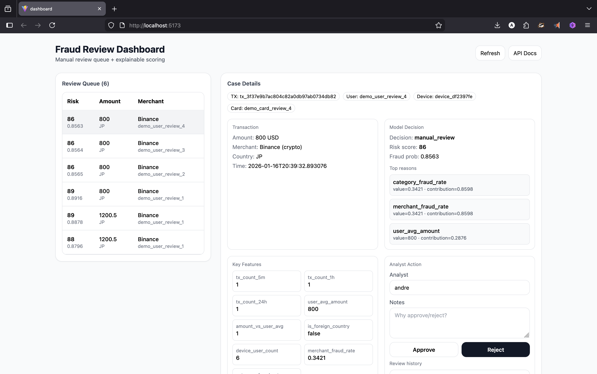

# Real-Time Fraud Detection Platform

> **Enterprise-style, end-to-end fintech fraud detection system built as a portfolio showcase project**

This project simulates a **real-world payment fraud detection platform** similar to what you would find inside banks, fintech startups, or payment processors.

It demonstrates:

- Streaming transaction ingestion  
- Feature engineering in real time  
- Risk scoring  
- Decisioning (approve / manual review / block)  
- Human review workflow  
- Operational dashboard  
- Full Dockerized deployment  

The implementation combines a transaction simulator, rule-based scoring, a review workflow, and a dashboard for exploring fraud decisions.

---

## Architecture Diagram



## Project Goals

This repository is meant to be a **portfolio-level, high-impact showcase project** demonstrating:

- Backend engineering  
- Data engineering  
- Risk scoring logic  
- DevOps / containerization  
- Frontend dashboard development  
- System design thinking  


---

## What Problem Does This Solve?

Financial fraud costs companies **billions of dollars per year**.

Modern fintech systems must:

- Process thousands of transactions per second  
- Detect suspicious activity instantly  
- Balance fraud prevention with customer experience  
- Allow human reviewers to intervene  
- Track risk over time  

This platform mimics that environment.

---

## System Architecture

```
+--------------------+
| Transaction Source |
+---------+----------+
          |
          v
+--------------------+       +-------------------+
| FastAPI Backend    | ----> | PostgreSQL DB     |
| (Scoring Engine)   |       |                   |
+---------+----------+       +-------------------+
          |
          v
+--------------------+
| React Dashboard    |
+--------------------+
```

---

## Features Implemented

### Real-Time Feature Engineering

For every transaction, the system calculates:

- Transaction count in last 5 minutes  
- Transaction count in last 1 hour  
- Transaction count in last 24 hours  
- User average amount  
- Amount vs user average  
- Merchant fraud rate  
- Category fraud rate  
- Device usage patterns  
- Foreign country detection  

### Fraud Scoring Engine

Each transaction receives:

- `fraud_probability` (0 – 1)
- `risk_score` (0 – 100)

Decision logic:

| Score | Result |
|------|-------|
| < 40 | APPROVE |
| 40–70 | MANUAL REVIEW |
| > 70 | BLOCK |

---

## Quick Start

### Prerequisites

- Docker  
- Docker Compose  
- Node.js  
- Python 3.10+  

### Run Everything with Docker

From project root:

```
docker compose -f docker-compose.full.yml up --build
```

### Access Points

| Service | URL |
|-------|-----|
| API | http://localhost:8000 |
| Dashboard | http://localhost:5173 |
| API Docs | http://localhost:8000/docs |

---

## Example Usage

### Score a Transaction

```
curl -X POST "http://localhost:8000/transactions/score" \
  -H "Content-Type: application/json" \
  -d '{
    "user_id":"demo_user_1",
    "card_id":"demo_card_1",
    "device_id":"demo_device_1",
    "amount": 2400.50,
    "currency":"USD",
    "merchant":"Binance",
    "merchant_category":"crypto",
    "country":"JP"
  }'
```

---

## Project Structure

```
fraud-detection-platform/
│
├── api/                    # FastAPI backend
│   ├── main.py
│   ├── features/
│   ├── models/
│   └── scoring/
│
├── dashboard/              # React frontend
│   ├── src/
│   ├── App.jsx
│   └── package.json
│
├── database/               # SQL schema
│   └── 00_init.sql
│
├── docker-compose.full.yml
└── README.md
```

---

## Technologies Used

### Backend
- Python 3.12  
- FastAPI  
- psycopg2  
- PostgreSQL  

### Frontend
- React  
- Vite  
- TailwindCSS  

### DevOps
- Docker  
- Docker Compose  
- Nginx  

---

## Future Improvements

Possible extensions:

- Extend statistical risk scoring  
- Kafka streaming ingestion  
- Prometheus monitoring  
- Authentication system  
- User behavior profiling  
- Multi-currency normalization  
- Admin analytics dashboard  
- Alerting system  

---

## About This Project

This platform was built as a **high-impact portfolio project** to demonstrate:

- Full-stack engineering ability  
- Understanding of real-world fintech problems  
- System design skills  
- Practical statistical analysis  
- Production mindset  

---

## Contributing

Feel free to fork the project and extend it.

---

## License

MIT License – free to use for learning purposes.
